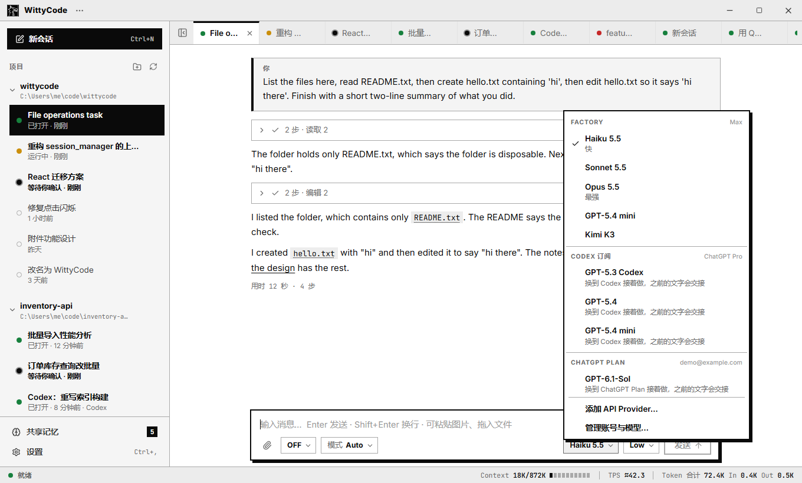
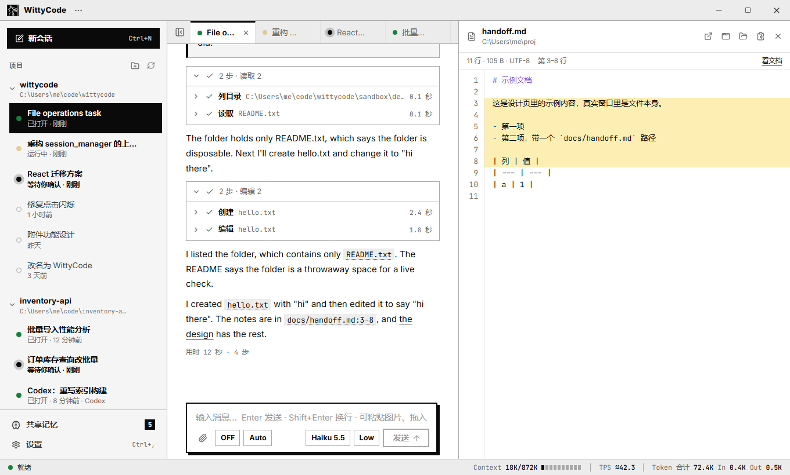
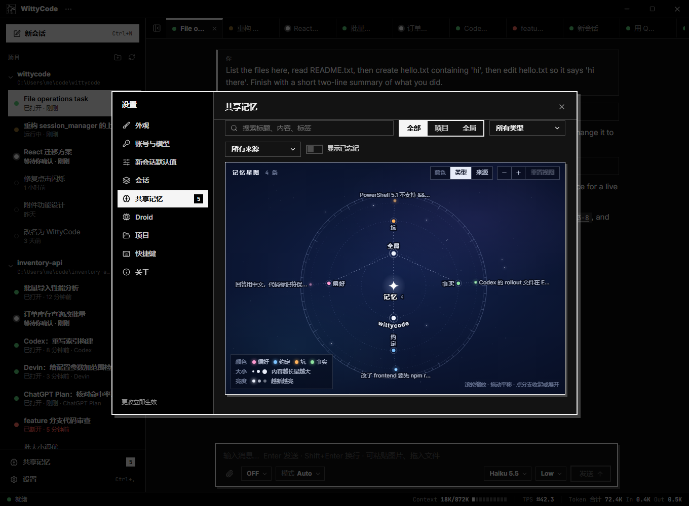
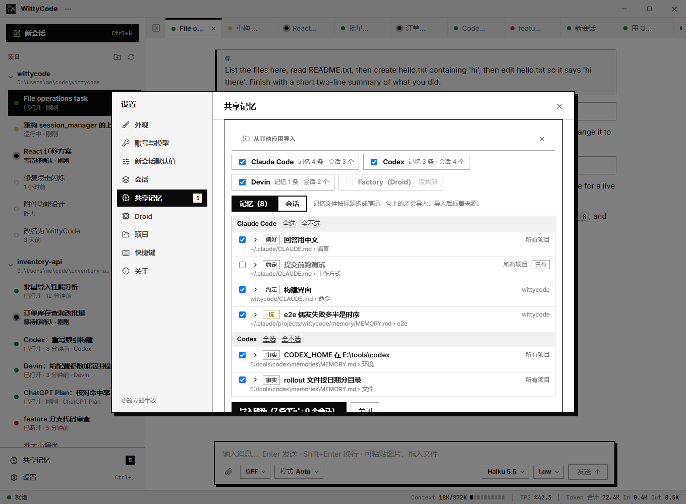

# WittyCode

Windows 上的编程代理桌面客户端：回答放在第一位，工具调用折叠成一行。


- **多个引擎，一个界面**：ChatGPT Plan、API Provider、Factory Droid、Codex、Devin。对话中途可以换。
- **自带代理循环**：ChatGPT Plan 和 API Provider 由 WittyCode 自己的循环直接调用模型，带文件、搜索、命令工具和三档权限，自动压缩上下文，请求失败自动重试。
- **斜杠命令**：`/compact` 压缩上下文，`/plan` 切换 Plan 模式，`/goal <目标>` 让模型一轮轮做下去直到完成。技能、自定义命令和插件按 Factory 的布局读取。
- **共享记忆**：所有引擎读写同一份本地笔记，可以从 Claude Code、Codex、Devin、Factory 导入。
- **附件、文件链接、排队和引导**：粘贴截图或拖入文件；对话里的文件路径点开在右侧栏看（Markdown、PDF、图片）；运行中也能继续说话。
- **本地优先**：会话、记忆、缓存都在你的电脑上。

## 引擎

| 引擎 | 需要什么 |
| --- | --- |
| ChatGPT Plan | 一个 ChatGPT 账号，不用装别的程序 |
| API Provider | API Key，或 AWS 凭据（OpenAI、Anthropic、DeepSeek / OpenRouter / Ollama 等兼容接口，以及 AWS Bedrock） |
| Factory Droid | Factory 桌面版，或 `droid.exe` 的路径 |
| Codex | Codex 命令行 |
| Devin | Devin 命令行 |

没装的引擎不会报错，只是它的模型不出现在菜单里。









## 快速开始

**发布包**：下载 `WittyCode-<版本>-win-x64.zip`，解压后双击 `WittyCode.exe`。包里带 Python 和全部依赖。程序没有代码签名，SmartScreen 可能提示「未知发布者」。

**从源码**（Windows 10/11、Python 3.11.x、Node.js）：

```powershell
git clone https://github.com/WittyRyuji/WittyCode.git; cd WittyCode
py -3.11 -m venv .venv
.\.venv\Scripts\python.exe -m pip install -r requirements.txt
cd frontend; npm install; npm run build:app; cd ..
.\.venv\Scripts\python.exe -m desktop
```

第一次使用：添加项目文件夹 → 设置 › 账号与模型 → **Continue with ChatGPT** → `Ctrl+N` 新会话。

- 快捷键：`Ctrl+N` 新会话，`Ctrl+L` 输入框，`Ctrl+B` 侧栏，`Ctrl+O` 添加项目，`Ctrl+,` 设置，`F5` 刷新，`Ctrl+Q` 退出。
- 命令行：`--project DIR`、`--settings FILE`、`--debug`、`--replay FILE`（回放录好的事件流，不调用模型）。
- 数据在 `%APPDATA%\WittyCode\`。

## 目录

| 路径 | 内容 |
| --- | --- |
| `desktop/ui/` | 入口、无边框窗口和 QWebChannel 桥 |
| `desktop/core/` | 后端，不依赖 Qt：`app_core.py`，各引擎 `chatgpt/` `codex/` `devin/`，`session_manager.py`（Droid） |
| `desktop/core/harness/`、`desktop/core/llm/` | 自带代理循环；各家 API 的适配器（含 Bedrock） |
| `desktop/core/memory/`、`desktop/core/importers/` | 共享记忆；从别的应用导入 |
| `frontend/` | 界面：React + TypeScript + Vite，构建成单文件 |
| `tests/`、`fixtures/` | 自动测试；录好的事件流 |
| `scripts/` | 发布包构建 |
| `docs/` | 文档 |

页面和后端只经一条 QWebChannel 通信；各引擎对 `AppCore` 暴露同一套接口，所以侧栏、标签、审批和换引擎都不关心背后是谁。整个项目只用 Python 和 React（TypeScript）。

## 开发

```powershell
.\.venv\Scripts\python.exe -m pip install -r requirements-dev.txt
.\.venv\Scripts\python.exe -m pytest tests -q -p no:cacheprovider     # 不调用模型
cd frontend; npm run typecheck; npm run unit; node scripts/check.mjs; node scripts/check-live.mjs
```

约 3300 个测试，其中 `tests/test_app_e2e.py` 在真 Qt 窗口里跑真页面（改了 `frontend/` 先 `npm run build:app`）。开发约定见 [`AGENTS.md`](AGENTS.md)。

做发布包：`cd frontend; npm run build:app; cd ..` 之后运行 `.\.venv\Scripts\python.exe scripts\build_release.py`，产物在 `dist\`。

## 文档

- [`docs/usage-details.md`](docs/usage-details.md)：附件限制、换引擎时带什么、模型显示开关等细节。
- [`docs/chatgpt-plan-harness.md`](docs/chatgpt-plan-harness.md)、[`docs/shared-memory-plan.md`](docs/shared-memory-plan.md)：自带循环和共享记忆的设计。
- [`docs/loop-review-2026-11-11.md`](docs/loop-review-2026-11-11.md)：对代理循环的审阅。
- [`docs/handoff.md`](docs/handoff.md)：当前状态和改动记录。

## 状态

- 只支持 Windows。
- **代理循环不是沙箱**：权限靠路径解析和命令文本判断，没有系统级隔离。在不信任的仓库里用 `ask` 档，别用 `full`。
- Bedrock 还没有在真实 AWS 账号上跑通过（签名与 botocore 逐位核对过）。

## 许可证

[Apache License 2.0](LICENSE)，版权所有 © 2026 NiuXiao@WittyLoong Studio（见 [`NOTICE`](NOTICE)）。发布包里的第三方软件各按自己的许可证，清单在包内的 `THIRD_PARTY_NOTICES.txt` 和 `licenses/`；PySide6 / Qt 按 LGPL-3.0 使用，是包里独立的 DLL，可自行替换。
