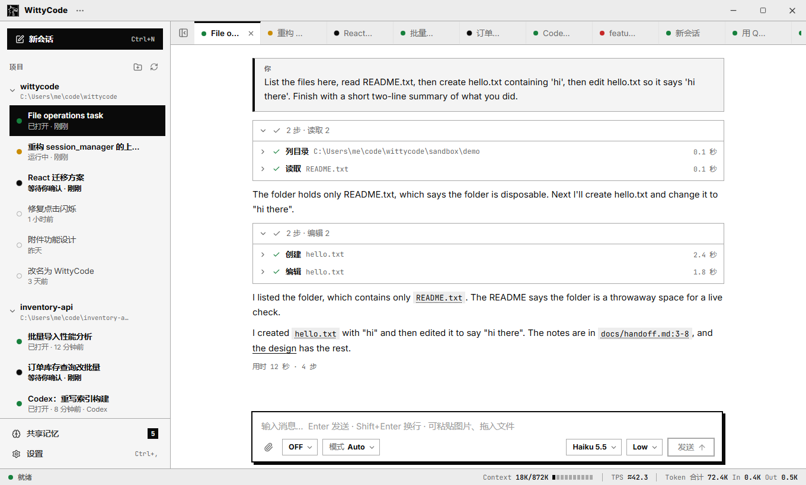

# WittyCode

English | [简体中文](README.zh-CN.md) | [Wiki](https://deepwiki.com/WittyRyuji/WittyCode)

[](https://github.com/WittyRyuji/WittyCode/actions/workflows/ci.yml)
[](https://github.com/WittyRyuji/WittyCode/actions/workflows/codeql.yml)
[](https://deepwiki.com/WittyRyuji/WittyCode)

WittyCode is a Windows desktop app for working with coding agents. Use WittyCode's own agent loop with your ChatGPT account or API provider, or choose **Fusion** to have a main agent coordinate a team on the same project. Tool calls fold into summaries so the conversation stays readable.



## What you can do

- **Work in one conversation across models.** WittyHarness handles tools, permission prompts, retries, and context compaction. Switch models without losing the conversation's visible history; the handoff carries relevant context, and you choose which attachments cross engines. View context and token usage and choose which models appear in the picker.
- **Plan before editing.** In Plan mode, WittyHarness and Fusion explore read-only. Work starts only after you approve the current proposal. During a run, answer questions and permission requests in cards, queue a follow-up, or steer where the engine supports it. Use `/plan`, `/goal <goal>`, `/compact`, and installed skills from the composer.
- **Open files without leaving the conversation.** Click a project-relative path, including a line reference, to open the resizable preview. It handles source code, Markdown, PDF, images (including animated GIFs), common videos such as MP4 and WebM with supported codecs, and `.docx`, `.xlsx`, and `.pptx` (simplified slides). Paste, drop, or pick files to attach. A vision-capable model can also see supported images read with `read_file`; preview support does not mean a file can be sent as an attachment.
- **Keep projects and memory local.** Organize conversations by project, import supported conversations and notes from other apps, and share searchable project or global memory across supported engines. Set defaults for new conversations, edit global and project rules, and choose WAV or MP3 sounds for questions, completion, and errors, or mute notifications.
- **Manage extensions in Settings.** Preview and confirm imports of supported local Skills, Plugins, command Hooks, and MCP configurations. Add stdio or Streamable HTTP MCP servers, or browse skills from the public OpenAI and Anthropic repositories. The built-in test-cleanup hook covers tests run through its managed entry point. GitHub and Google Workspace connectors are available only in builds configured with the publisher's OAuth client IDs. See the [Connections guide](docs/connections.md) and [Settings guide](docs/settings-plugins.md).

### Fusion and Agents Team

Select **Fusion** in the composer and configure the main, work, and lightweight models and their reasoning levels in Settings. With the default routing gates enabled, multi-step edits go to a **Coder**. **Runner** and **QualitySampler** handle checks and review without edit tools. Coders can reuse their workstream context, and independent assignments with non-overlapping write scopes can run in parallel. The main agent checks the results and flags work if required verification is missing.

The **Agents Team** panel shows a zoomable, animated task graph and pixel dragons that reflect each agent's state. Select an agent to inspect its brief, activity, evidence, and reported token usage. **Fusion Drive** keeps task briefs, reports, and evidence in a local project store. You can choose to keep the project map local or write it to `.witty_map.md` in the project. See the [Fusion guide](docs/fusion.md) for setup, compatibility, and limits.

## Get started

**Windows 10/11 x64 · Alpha · Chinese interface.** When a build is available on [GitHub Releases](https://github.com/WittyRyuji/WittyCode/releases), download the `WittyCode-<version>-win-x64.zip` and its `.sha256`, verify the checksum, then unzip and run `WittyCode.exe`. The ZIP includes Python and the runtime dependencies. Builds are not code-signed yet. There is no in-app updater; download new builds manually.

**Run from source** with Python **3.11.9** and Node.js **24.20.0**. The feature list describes the development source; `main` and any tagged downloads may not include all of it. Use `git switch dev` after cloning to follow the current development branch.

```powershell
git clone https://github.com/WittyRyuji/WittyCode.git
cd WittyCode
py -3.11 -m venv .venv
.\.venv\Scripts\python.exe -m pip install -r requirements.txt -c constraints.txt
cd frontend
npm ci
npm run build:app
cd ..
.\.venv\Scripts\python.exe -m desktop
```

Add a project folder, then open **Settings → Accounts & Models** and choose a model source:

| Source | What you need |
| --- | --- |
| ChatGPT Plan | Sign in with your ChatGPT account; no separate CLI required |
| API provider | OpenAI, Anthropic, an OpenAI-compatible endpoint (e.g. DeepSeek, OpenRouter, or Ollama), or AWS credentials for Bedrock |
| Devin (optional) | Devin CLI or desktop app; use a compatible ACP setup for Fusion |
| Factory (optional) | Factory CLI signed in separately; no Factory SDK required |

Press `Ctrl+N` to start a conversation. `Ctrl+O` adds a project, `Ctrl+L` focuses the composer, `Ctrl+B` toggles the sidebar, and `Ctrl+,` opens Settings. From the command line, use `--project DIR`, `--settings FILE`, or `--debug`. See the [usage guide](docs/usage-details.md), including how to try the app with a recording instead of a model.

**Data and permissions:** WittyCode keeps its own conversation and memory data locally in `%APPDATA%\WittyCode\` by default and has no telemetry. Model providers and connectors still receive the inputs you send them. Tool permissions and write scopes are **not an OS sandbox**. Review commands and extensions before allowing them to run; do not use full access in an untrusted repository. Bedrock and Factory are not yet verified end to end against real accounts.

## Release notes and development

[GitHub Releases](https://github.com/WittyRyuji/WittyCode/releases) is where versioned downloads and release notes appear. Pushing a `v*` tag that matches `pyproject.toml` triggers the [Release workflow](.github/workflows/release.yml). If validation and packaging succeed, it publishes the Windows ZIP and checksum, with build provenance. It uses `docs/releases/<tag>.md` when present or asks GitHub to generate the notes. Ordinary pushes update the branch, not the Releases page.

The app uses Python and a React/TypeScript frontend connected over Qt WebChannel. See the [project overview](docs/project.md) for the layout, the [development guide](docs/development.md) for builds and tests, the [roadmap](ROADMAP.md) for planned work, and [CONTRIBUTING.md](CONTRIBUTING.md) or [SECURITY.md](SECURITY.md) to get involved or report a vulnerability.

```powershell
.\.venv\Scripts\python.exe scripts/check_ci.py --clean
.\.venv\Scripts\python.exe scripts/check_ci.py --clean --part windows
```

The first command runs the CI checks in an isolated copy. The second runs the whole-window Qt suites, which are not part of CI. Neither calls a model.

## License

[Apache License 2.0](LICENSE), © 2026 NiuXiao@WittyLoong Studio (see [NOTICE](NOTICE)). Third-party software keeps its own license; the ZIP includes `THIRD_PARTY_NOTICES.txt` and `licenses/`. PySide6 / Qt is distributed as separate, replaceable DLLs under LGPL-3.0.
