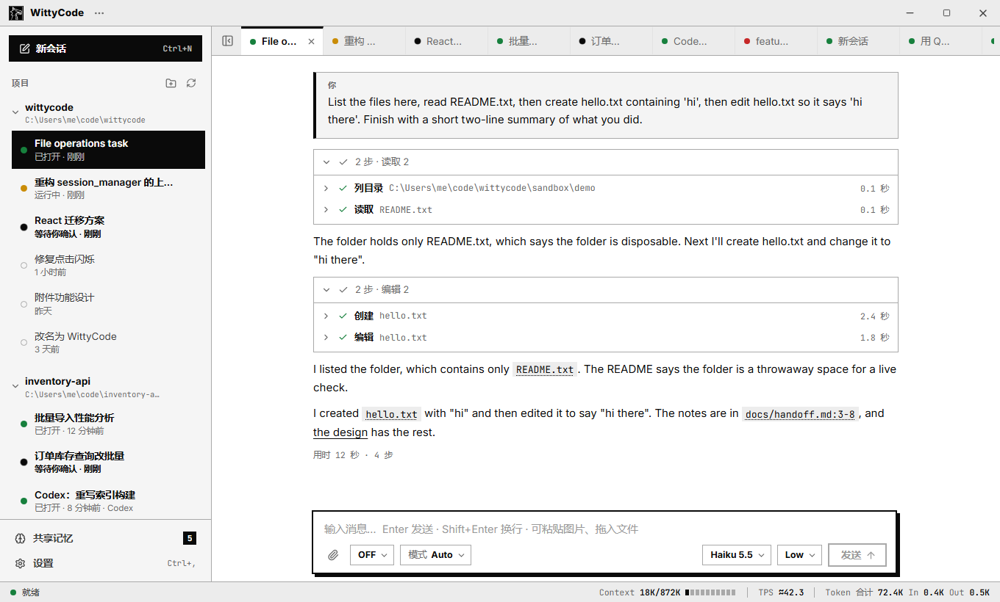

# WittyCode

English | [简体中文](README.zh-CN.md) | [Wiki](https://deepwiki.com/WittyRyuji/WittyCode)

[](https://github.com/WittyRyuji/WittyCode/actions/workflows/ci.yml)
[](https://github.com/WittyRyuji/WittyCode/actions/workflows/codeql.yml)
[](https://deepwiki.com/WittyRyuji/WittyCode)

A coding-agent desktop app for Windows, with its own agent loop: the answer comes first, tool calls fold into one line.



- **Its own agent loop**: WittyCode calls the model itself — with your ChatGPT plan ("Sign in with ChatGPT") or your own API providers — and runs file, search and shell tools behind three permission levels. Long conversations are compacted, failed requests retried.
- **One window for every model**: ChatGPT Plan, API providers (OpenAI, Anthropic, OpenAI-compatible endpoints such as DeepSeek / OpenRouter / Ollama, and AWS Bedrock), and optionally Devin or Factory CLI. A conversation can move to another model midway; the earlier text goes along.
- **Asks while it works**: approvals and questions show up as cards, one answer per line; messages typed while a turn runs are queued or given to the running turn (steer).
- **Slash commands and skills**: `/compact`, `/plan`, `/goal <goal>`; your skills and custom commands from `.wittycode/` (and the folders other agent apps use).
- **Shared memory**: one set of local notes every engine reads and writes; notes and conversations can be imported from other apps.
- **Local first**: conversations, memory and cache stay on your machine. No telemetry.

Settings → **Connections** manages local Codex-format Skills, Plugins, command Hooks and stdio MCP with an import preview and explicit trust. See the [connection guide](docs/connections.md) (Chinese) for supported formats and limits.

See the [Roadmap](ROADMAP.md) for what comes next.

## Engines

| Engine | What it needs |
| --- | --- |
| ChatGPT Plan | A ChatGPT account; nothing else to install |
| API Provider | An API key, or AWS credentials for Bedrock |
| Devin (optional) | The Devin CLI or the Devin desktop app |
| Factory (optional) | Factory CLI, signed in separately; no Factory SDK |

WittyCode itself depends on no other agent program. An engine that is not set up just has no models in the menu.

## Getting started

**Release**: download `WittyCode-<version>-win-x64.zip` from [Releases](https://github.com/WittyRyuji/WittyCode/releases), check it against the `.sha256` file, unzip it and run `WittyCode.exe`. Python and every dependency are inside. The app is not code-signed yet, so SmartScreen may say "unknown publisher".

**From source** (Windows 10/11, Python 3.11.x, Node.js 24):

```powershell
git clone https://github.com/WittyRyuji/WittyCode.git; cd WittyCode
py -3.11 -m venv .venv
.\.venv\Scripts\python.exe -m pip install -r requirements.txt -c constraints.txt
cd frontend; npm ci; npm run build:app; cd ..
.\.venv\Scripts\python.exe -m desktop
```

First run: add a project folder → Settings › Accounts & models → **Continue with ChatGPT** (or add an API provider) → `Ctrl+N`.

- Shortcuts: `Ctrl+N` new conversation, `Ctrl+L` message box, `Ctrl+B` sidebar, `Ctrl+O` add project, `Ctrl+,` settings, `F5` refresh, `Ctrl+Q` quit.
- Command line: `--project DIR`, `--settings FILE`, `--debug`.
- Data lives in `%APPDATA%\WittyCode\`.

The interface is in Chinese for now; an English interface is on the [Roadmap](ROADMAP.md).

## Layout

| Path | What |
| --- | --- |
| `desktop/ui/` | Entry point, the frameless window, the QWebChannel bridge |
| `desktop/core/` | Back end, no Qt: `app_core.py`; the own loop in `chatgpt/`, `harness/`, `llm/`; optional `devin/` and `factory.py` engines; `connections.py` for local extensions |
| `desktop/core/memory/`, `desktop/core/importers/` | Shared memory; importing from other apps |
| `frontend/` | The page: React + TypeScript + Vite, built into one file |
| `tests/` | Automated tests (no model is called) |
| `scripts/` | Release build and checks |
| `docs/` | Documentation (Chinese) |

The page and the back end talk over a single QWebChannel; every engine offers `AppCore` the same interface. The project uses only Python and React (TypeScript).

## Development

```powershell
.\.venv\Scripts\python.exe -m pip install -r requirements-dev.txt -c constraints.txt
.\.venv\Scripts\python.exe scripts/check_ci.py --clean
# Whole-window tests run separately, locally (build the page first):
.\.venv\Scripts\python.exe scripts/check_ci.py --part windows
```

Use Python 3.11.9 and Node 24.20.0, matching CI. The clean entry installs pinned dependencies in an isolated copy and runs the same checks as CI and releases, including Qt’s real QWebChannel client. The whole-window suites run the real React page in Qt and remain local-only. See [CONTRIBUTING.md](CONTRIBUTING.md) before opening a pull request, and [SECURITY.md](SECURITY.md) to report a vulnerability.

Release build: `cd frontend; npm run build:app; cd ..`, then `.\.venv\Scripts\python.exe scripts\build_release.py`; the zip is in `dist\`. Tagged releases are built by GitHub Actions.

## Status

- Alpha. Windows 10/11 x64 only.
- **The agent loop is not a sandbox**: permissions are decided from resolved paths and command text, with no OS-level isolation. Use the `ask` level in repositories you do not trust, never `full`. A sandbox is on the [Roadmap](ROADMAP.md).
- Bedrock has not yet completed a real request against an AWS account (the signing was checked against botocore).

## License

[Apache License 2.0](LICENSE), © 2026 NiuXiao@WittyLoong Studio (see [`NOTICE`](NOTICE)). Third-party software in the release keeps its own license, listed in `THIRD_PARTY_NOTICES.txt` and `licenses/` inside the zip; PySide6 / Qt is used under LGPL-3.0 as separate, replaceable DLLs.
