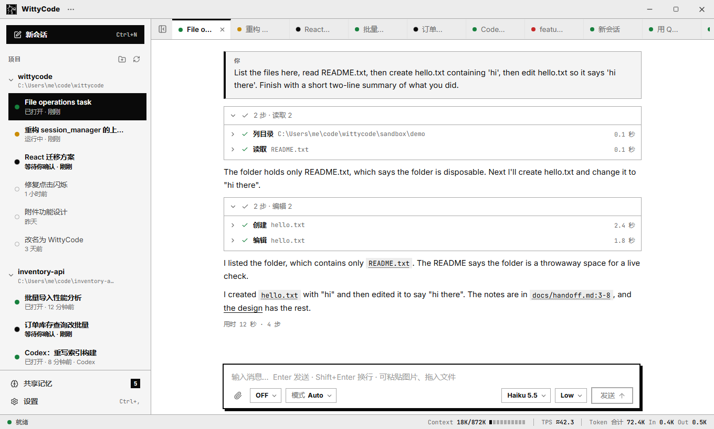

# WittyCode

[English](README.md) | 简体中文 | [Wiki](https://deepwiki.com/WittyRyuji/WittyCode)

[](https://github.com/WittyRyuji/WittyCode/actions/workflows/ci.yml)
[](https://github.com/WittyRyuji/WittyCode/actions/workflows/codeql.yml)
[](https://deepwiki.com/WittyRyuji/WittyCode)

WittyCode 是 Windows 上的编程代理桌面应用。可以用 ChatGPT 账号或自己的 API 接入自带的代理循环，也可以选择 **Fusion**，由主代理协调一组专家在同一个项目里工作。工具调用折叠成摘要，不打断对话阅读。



## 能做什么

- **在同一个会话里换模型。** WittyHarness 自己处理工具调用、权限确认、请求重试和上下文压缩。换模型时保留可见历史，按需交接上下文；跨引擎要带哪些附件，由你选择。可以查看上下文和 Token 用量，也可以设置模型菜单显示哪些模型。
- **先审方案，再动手。** WittyHarness 和 Fusion 的 Plan 模式只读探索，明确批准当前版本的方案后才执行。运行中的提问与权限确认用卡片展示；可以将后续消息排队，在引擎支持时也可以直接引导本轮。输入框支持 `/plan`、`/goal <目标>`、`/compact` 和已安装的技能。
- **在对话里直接看文件。** 点击项目相对路径或行号引用，在可拖宽的侧栏查看源码、Markdown、PDF、图片（含 GIF 动图）、受支持编码的 MP4／WebM 等常见视频，以及 `.docx`、`.xlsx`、`.pptx`（幻灯片简化展示）。可粘贴、拖入或选择附件。支持视觉的模型也可通过 `read_file` 查看受支持的图片；能预览不等于能当附件发送。
- **管理项目、会话与本地记忆。** 按项目组织会话，导入支持的历史会话和笔记，让支持的引擎共用可搜索的项目或全局记忆。可以配置新会话默认值、编辑全局和项目规则，并分别选择问题、完成、错误提示音（WAV 或 MP3），也可以关闭所有提示音。
- **在设置里管理扩展。** 预览并确认导入受支持的本地 Skills、Plugins、命令 Hooks 和 MCP 配置；可添加 stdio 或 Streamable HTTP MCP，也可浏览 OpenAI、Anthropic 官方公开技能目录。内置「测试收尾」Hook 只覆盖通过托管入口运行的测试。GitHub 和 Google Workspace 连接器仅在发布者配置对应 OAuth Client ID 后才可用。详见[连接指南](docs/connections.md)和[设置指南](docs/settings-plugins.md)。

### Fusion 与 Agents Team

在输入框的模型菜单选 **Fusion**，再到设置里为主模型、工作模型、轻量模型分别选择模型和推理强度。默认路由关卡开启时，多步改动交给 **Coder**；**Runner** 和 **QualitySampler** 负责检查和审查，没有编辑工具。Coder 可复用同一职责的上下文，互不依赖、写入范围不重叠的任务可以并行。主代理汇总结果，缺少要求的验证时会标明未验证。

右侧 **Agents Team** 用可缩放的动画流程图和像素龙显示各专家的状态。点专家可查看任务书、工作记录、证据和 Token 明细。**Fusion Drive** 在本地项目库里保留任务书、回报和证据；项目地图可只存本机，也可写到项目里的 `.witty_map.md`。配置、兼容范围和限制见 [Fusion 指南](docs/fusion.md)。

## 快速开始

**Windows 10/11 x64 · Alpha。** [GitHub Releases](https://github.com/WittyRyuji/WittyCode/releases) 有发布包时，下载 `WittyCode-<版本>-win-x64.zip` 和对应的 `.sha256`，核对校验值后解压，运行 `WittyCode.exe`。包内包含 Python 和运行依赖，暂未做代码签名。应用不提供自动更新，新版本需要手动下载。

**从源码运行**需要 Python **3.11.9** 和 Node.js **24.22.3**。本文功能以开发源码为准，`main` 和已打标签的下载包不一定都包含；克隆后可用 `git switch dev` 切换到开发分支。

```powershell
git clone https://github.com/WittyRyuji/WittyCode.git
cd WittyCode
py -3.11 -m venv .venv
.\.venv\Scripts\python.exe -m pip install -r requirements.txt -c constraints.txt
cd frontend
npm ci
npm run build:app
cd ..
.\.venv\Scripts\python.exe -m desktop
```

第一次使用时，先添加项目文件夹，再到**设置 → 账号与模型**选择模型来源：

| 来源 | 需要什么 |
| --- | --- |
| ChatGPT Plan | 用 ChatGPT 账号登录，无需安装独立 CLI |
| API Provider | OpenAI、Anthropic、OpenAI 兼容接口（如 DeepSeek、OpenRouter、Ollama），或 Bedrock 所需的 AWS 凭据 |
| Devin（可选） | Devin CLI 或桌面应用；在 Fusion 中使用需要兼容的 ACP 配置 |
| Factory（可选） | 单独登录的 Factory CLI，不依赖 Factory SDK |

API Provider 默认推荐使用**环境变量**。如选择「**直接输入（不推荐）**」，WittyCode 会用当前 Windows 用户的加密机制保存密钥。编辑时留空保留；改接口类型或 Base URL 后，需重新输入密钥或选择其他来源。Bedrock 仍使用单独的 AWS 凭据设置。

`Ctrl+N` 新建会话，`Ctrl+O` 添加项目，`Ctrl+L` 聚焦输入框，`Ctrl+B` 开关侧栏，`Ctrl+,` 打开设置。命令行支持 `--project DIR`、`--settings FILE`、`--debug`。也可以离线回放录制，不用调用模型；见[使用指南](docs/usage-details.md)。

**数据与权限：** WittyCode 自己的会话和记忆默认保存在 `%APPDATA%\WittyCode\`，没有遥测。发给模型服务或连接器的内容仍会发送给对应服务。应用的工具权限与写入范围**不是操作系统级沙箱**。只运行信任的命令与扩展；不信任的项目不要开「完全访问」。Bedrock 和 Factory 尚未在真实账号上完成端到端验证。

## 发布说明与开发

[GitHub Releases](https://github.com/WittyRyuji/WittyCode/releases) 集中展示按版本发布的下载包和更新说明。推送与 `pyproject.toml` 版本匹配的 `v*` 标签会触发[发布流程](.github/workflows/release.yml)。验证和构建通过后，流程发布 Windows ZIP、SHA-256 校验文件及构建来源证明；有 `docs/releases/<标签>.md` 就用其中的说明，否则让 GitHub 自动生成。普通分支推送不会新增 Release。

应用使用 Python 后端和 React／TypeScript 界面，通过 Qt WebChannel 通信。目录结构见[项目概况](docs/project.md)，构建和测试见[开发指南](docs/development.md)，计划见[路线图](ROADMAP.zh-CN.md)。参与贡献和报告漏洞分别见 [CONTRIBUTING.md](CONTRIBUTING.md) 和 [SECURITY.md](SECURITY.md)。

```powershell
.\.venv\Scripts\python.exe scripts/check_ci.py --clean
.\.venv\Scripts\python.exe scripts/check_ci.py --clean --part windows
```

第一条在隔离副本里运行 CI 检查；第二条运行不纳入 CI 的 Qt 整机测试。两个入口均不调用真实模型。

## 许可证

[Apache License 2.0](LICENSE)，版权所有 © 2026 NiuXiao@WittyLoong Studio（见 [NOTICE](NOTICE)）。第三方软件遵循各自的许可证，清单在 ZIP 内的 `THIRD_PARTY_NOTICES.txt` 和 `licenses/`。PySide6／Qt 按 LGPL-3.0 作为独立可替换的 DLL 分发。
