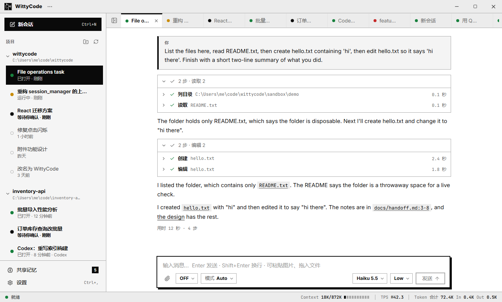

# WittyCode

[English](README.md) | 简体中文 | [Wiki](https://deepwiki.com/WittyRyuji/WittyCode)

[](https://github.com/WittyRyuji/WittyCode/actions/workflows/ci.yml)
[](https://github.com/WittyRyuji/WittyCode/actions/workflows/codeql.yml)
[](https://deepwiki.com/WittyRyuji/WittyCode)

Windows 上的编程代理桌面应用，自带代理循环：回答放在第一位，工具调用折叠成一行。



- **自带代理循环**：WittyCode 自己调用模型——用你的 ChatGPT 套餐（Sign in with ChatGPT）或你自己的 API Provider——带文件、搜索、命令工具和三档权限；长对话自动压缩，请求失败自动重试。
- **所有模型一个界面**：ChatGPT Plan、API Provider（OpenAI、Anthropic、DeepSeek / OpenRouter / Ollama 等兼容接口，以及 AWS Bedrock），可选 Devin。对话中途可以换模型，之前的文字会交接过去。
- **运行中也能问答**：审批和提问显示成卡片，选项一行一个；运行中打的字可以排队，也可以立即引导本轮。
- **斜杠命令和技能**：`/compact`、`/plan`、`/goal <目标>`；技能和自定义命令放在 `.wittycode/`（也读其他代理应用常用的目录）。
- **共享记忆**：所有引擎读写同一份本地笔记，可以从别的应用导入笔记和会话。
- **本地优先**：会话、记忆、缓存都在你的电脑上，没有遥测。

接下来要做什么见 [Roadmap](ROADMAP.zh-CN.md)。

## 引擎

| 引擎 | 需要什么 |
| --- | --- |
| ChatGPT Plan | 一个 ChatGPT 账号，不用装别的程序 |
| API Provider | API Key，或 Bedrock 用的 AWS 凭据 |
| Devin（可选） | Devin 命令行或 Devin 桌面版 |

WittyCode 本身不依赖任何别的代理程序。没设置的引擎不会报错，只是它的模型不出现在菜单里。

## 快速开始

**发布包**：从 [Releases](https://github.com/WittyRyuji/WittyCode/releases) 下载 `WittyCode-<版本>-win-x64.zip`，用 `.sha256` 文件核对后解压，双击 `WittyCode.exe`。包里带 Python 和全部依赖。程序暂时没有代码签名，SmartScreen 可能提示「未知发布者」。

**从源码**（Windows 10/11、Python 3.11.x、Node.js 24）：

```powershell
git clone https://github.com/WittyRyuji/WittyCode.git; cd WittyCode
py -3.11 -m venv .venv
.\.venv\Scripts\python.exe -m pip install -r requirements.txt -c constraints.txt
cd frontend; npm ci; npm run build:app; cd ..
.\.venv\Scripts\python.exe -m desktop
```

第一次使用：添加项目文件夹 → 设置 › 账号与模型 → **Continue with ChatGPT**（或添加 API Provider）→ `Ctrl+N`。

- 快捷键：`Ctrl+N` 新会话，`Ctrl+L` 输入框，`Ctrl+B` 侧栏，`Ctrl+O` 添加项目，`Ctrl+,` 设置，`F5` 刷新，`Ctrl+Q` 退出。
- 命令行：`--project DIR`、`--settings FILE`、`--debug`。
- 数据在 `%APPDATA%\WittyCode\`。

## 目录

| 路径 | 内容 |
| --- | --- |
| `desktop/ui/` | 入口、无边框窗口和 QWebChannel 桥 |
| `desktop/core/` | 后端，不依赖 Qt：`app_core.py`；自带循环在 `chatgpt/`、`harness/`、`llm/`；可选的 `devin/` 引擎 |
| `desktop/core/memory/`、`desktop/core/importers/` | 共享记忆；从别的应用导入 |
| `frontend/` | 界面：React + TypeScript + Vite，构建成单文件 |
| `tests/` | 自动测试（不调用模型） |
| `scripts/` | 发布包构建和检查 |
| `docs/` | 文档 |

页面和后端只经一条 QWebChannel 通信；各引擎对 `AppCore` 暴露同一套接口。整个项目只用 Python 和 React（TypeScript）。

## 开发

```powershell
.\.venv\Scripts\python.exe -m pip install -r requirements-dev.txt -c constraints.txt
.\.venv\Scripts\python.exe -m pytest tests -q -p no:cacheprovider
cd frontend; npm run typecheck; npm run unit; node scripts/check.mjs; node scripts/check-live.mjs
```

`tests/test_app_e2e.py` 在真 Qt 窗口里跑真页面（改了 `frontend/` 先 `npm run build:app`），只在本地跑；其余都在 CI 里跑。提 PR 前请看 [CONTRIBUTING.md](CONTRIBUTING.md)，报告漏洞请看 [SECURITY.md](SECURITY.md)。

做发布包：`cd frontend; npm run build:app; cd ..` 之后运行 `.\.venv\Scripts\python.exe scripts\build_release.py`，产物在 `dist\`。打 tag 时由 GitHub Actions 自动构建发布。

## 状态

- Alpha。只支持 Windows 10/11 x64。
- **代理循环不是沙箱**：权限靠路径解析和命令文本判断，没有系统级隔离。在不信任的仓库里用「询问」档，别用「完全访问」。沙箱在 [Roadmap](ROADMAP.zh-CN.md) 里。
- Bedrock 还没有在真实 AWS 账号上跑通过（签名与 botocore 逐位核对过）。

## 许可证

[Apache License 2.0](LICENSE)，版权所有 © 2026 NiuXiao@WittyLoong Studio（见 [`NOTICE`](NOTICE)）。发布包里的第三方软件各按自己的许可证，清单在包内的 `THIRD_PARTY_NOTICES.txt` 和 `licenses/`；PySide6 / Qt 按 LGPL-3.0 使用，是包里独立的 DLL，可自行替换。
