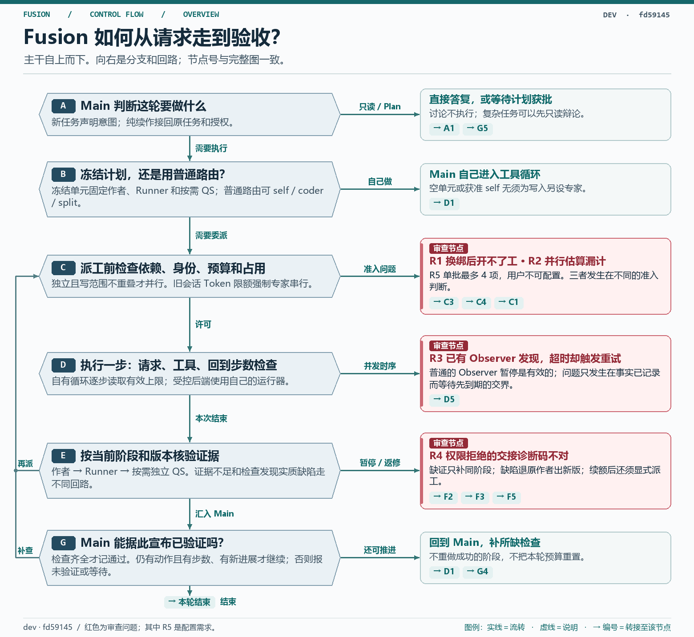

# Fusion 决策流程与 Harness 审查（2026-11-27）

基线：`dev` 的 `fd59145`，不是本地未提交的工作树。**最先应修的是冻结专家换绑后无法开工、并行派工漏算在途的计划估算，以及 Observer 发现与截止时间相撞时走错恢复分支。** 另有一个诊断错误和一个配置需求。本次没有修改运行时代码。多模型协作、单个专家到期后 Main 仍可推进其他工作，均是设计，不是缺陷。

[完整决策图（PNG，可放大）](fusion-loop-review-2026-11-27/flow.png) · [一页总览（PNG）](fusion-loop-review-2026-11-27/overview.png)

**读图方法：** A 是声明意图，B 是分配作者与检查者，C 是派工准入，D 是模型和工具循环，E 是交付凭据，F 是中断恢复，G 是最终验收。主线向下；横向箭头标明分支条件；`→ C2` 这类转接号指向原节点，不是新增一次请求。红色只用于以下五项。

## 1. R1 · P1 · 同席换绑成功，但有前任的冻结阶段仍不能运行（C3）

- **应当保证：** 可以换的是已授权的模型实例；不能换的是交付范围、专家目录版本、阶段和批准过的权限。保留前任的审计记录不等于导入前任的会话。
- **实际链路：** 冻结 Runner 已经运行过并返回 `blocked` → 原模型不再获授权，阶段进入 U07 → `replan` 成功选出同席替补并退役旧实例 → `resume`。注册表给新实例设置 `transferred_from`；委派器看到该标志便以「冻结单元不能导入转交会话」拒绝。离线流程中替补 **0 步、0 次工具调用**，作者回执仍在，单元卡在 Runner。若旧 Runner 从未开工，没有这个前任，不能用那条成功路径证明这里正常。
- **代码：** `desktop/core/fusion/runtime.py:2465–2512, 2889–2892`；`desktop/core/fusion/registry.py:159–174, 224–244, 246–269, 282–287`。`roster[stage].expert` 是目录稳定标识，不是子会话 ID；显式 `transfer()` 本身拒绝冻结实例。
- **最小修法及验收：** 为已批准的阶段换绑创建干净子会话，仅保留单独的前任审计引用，从原冻结包和已认证凭据恢复。**不要删除禁止导入旧会话的保护。** 分别验证「从未开工」和「已有旧实例」两种换绑均能实际产出新版 Runner 凭据；保存重开后还能接续，作者不重跑、下游不早放行。

## 2. R2 · P1 · 并行计划估算只看各项，没有合计在途项（C4）

- **应当保证：** 计划设的是复核阈值，不是对服务商账单的硬承诺。但如果连已经知道的两项输入估算相加都超标，程序不应分别放行而跳过复核。
- **实际链路：** 两个独立工作流都在首份用量回报前开工；`_plan_budget_gate` 两次各比较「已知实耗＋本项估算」。门禁探针使用阈值 **100**、两项各估 **60**，两个真实注册表名额都能进入 `running`。这是估算准入的缺口，**不是**实测消耗了 120 token，也**不是**旧会话 `max_tokens` 失去串行保护：同样的第二项在有旧上限时被 `begin()` 拒绝。
- **代码：** `desktop/core/fusion/runtime.py:1516–1533, 1925–1965, 2766–2781, 2900–2907`；`desktop/core/fusion/registry.py:360–396`。
- **最小修法及验收：** 对数值计划阈值，准入时原子预留本次输入估算；冻结首包算出后替换原预留，而非再加一次。用量到达时抵扣预留，结束、拒绝或取消时释放，未知用量仍走复核。回归覆盖「60＋60/100」、首包重估、取消释放、后续部分实耗不重复入账，以及无数值阈值仍能并行。

## 3. R3 · P1 · 已记录的 Observer 发现可被稍后的超时覆盖为重试原因（D5）

- **应当保证：** 「已知重复操作，等 Main 裁决」和「没完成检查，可延长时间重试」是不同原因。后到的计时器不能抹掉早已确定的事实。
- **实际链路：** 第三次相同的工具调用和结果产生 `repeat`，但工具批还没完全返回。这时委派的墙钟先到期，走异常分支而不是正常完成分支；旧只读 Runner 的回执成了 `Check attempt 1: timeout`，并额外启动一次检查。**普通 Observer 上报并没有丢失**：正常边界上，子循环会停，`delegate()` 也会查报告并交回 Main。
- **代码：** `desktop/core/chatgpt/controller.py:3030–3042`；`desktop/core/fusion/runtime.py:352–361, 3055–3067, 3170–3204`（基线行号）。
- **最小修法及验收：** 两个结束分支共用停止原因的优先级。截止时间到时若已有实质发现，保留该发现、暂停并交 Main，不设置检查重试原因；只有单纯的超时走预算恢复。用可控屏障覆盖「先有发现后到期」及「只有超时」，分别断言前者不重试、后者仍按既定策略恢复。

**工作树对照（不属于图的基线）：** 审查时工作树已有一处未提交的超时分支修正。另行运行 `test_queued_observer_finding_beats_check_deadline` 与 `test_check_timeout_recovers_with_observer`，两项均通过。无需据此重复修改该分支；本次文档提交不包含该修正。

## 4. R4 · P2 · 工具权限拒绝被诊断成环境中断（F2）

- **应当保证：** 用户不授权与系统缺前提应生成不同的交接说明。拒绝一次动作也不等于取消整个用户任务。
- **实际链路：** 委派结算写入 `permission denied`，但 `handoff()` 只把 `cancelled` 映射到 U06；未触其他上限时落入 U02。账本探针核对了原因与诊断码：原因为拒绝、诊断为环境或上下文中断。这是归因错误，**没有观察到权限被放行**。
- **代码：** `desktop/core/fusion/runtime.py:3254–3258`；`desktop/core/fusion/verification_case.py:367–387, 589–592`。
- **最小修法及验收：** 单独映射「权限被拒」到 U06，并保留可区分的原因和下一步；不要在 `settle_budget()` 中把它当成取消整项任务。回归验证拒绝只阻止原动作、独立单元仍可运行，普通环境失败仍是 U02，真正取消仍停止。

## 5. R5 · P2 · 用户不能设置每批同时派多少项（C1，配置需求）

- **现状：** 三种批量工具声明均写明最多 4 项，解析器实际接受 4、拒绝 5。冻结声明还单独写了数字 `4`。这是 `delegate_tasks` 的单批大小，不是 Harness 并行读取工具的数量，也不等同于已经存在整个会话共享的并发调度器。
- **代码：** `desktop/core/fusion/tools.py:14, 44–50, 116–120`；`desktop/core/fusion/protocol.py:56–59`；`desktop/core/harness/toolset.py:518–532`。
- **最小修法及验收：** 增加一个有界的 Fusion 并行设置，默认保留 4；让三种工具声明、参数校验、派工准入共用同一个生效值。若其含义是会话并发度，而不仅是批大小，跨批也须共享名额。测试 1、默认值、配置上界、跨批，以及旧 Token 上限仍强制串行。不要放宽写入互斥和依赖检查。

## 不再列为缺陷的两条判断

- **「续额后 `AgentLoop.max_steps` 固定不变」不成立。** 控制器传的是 `turn_step_limit` 方法，循环每步求值；冻结 `continue` 只记决定，下一次显式 `resume` 重算额度并开新运行。冻结续额回归中也确实以新额度推进到新版复核。见 `desktop/core/chatgpt/controller.py:629–631, 1384–1396`、`desktop/core/harness/loop.py:381–395`、`desktop/core/fusion/runtime.py:2591–2633`。
- **「取消并重新派冻结单元可清零三次上限」混淆了两套计数。** `CheckAttempt.number` 是旧只读任务书的一次调用内计数。探针在同一 Main 回合显式派两次，各有三次尝试；这不是一次取消触发无限自动重放。冻结单元在 `case.attempts`、历史和续额账本记录阶段尝试。若产品另需「同一交付版本跨手工派单的总上限」，应作为新策略指定，而非宣称冻结状态丢失。见 `desktop/core/fusion/runtime.py:2644–2673, 2783–2795`、`desktop/core/fusion/verification_case.py:270–297`。

## 验证边界

从 Git 单独导出 `fd59145` 的受测源码到本次托管测试临时区，不混用未提交的实现。使用本地假后端和账本探针，共运行 **146 项针对性检查，全部通过**：其中六项审查探针断言的是上述基线行为，探针通过不表示缺陷已修。其余覆盖 Harness 循环、冻结续额和恢复、旧检查重试、Observer、计划估算与注册表。**未运行全量测试，真实模型调用为 0。** 两张 PNG 均已打开目检，完整图的节点转接也已检查；没有把设计文档或多个模型正常协作本身当作缺陷证据。
